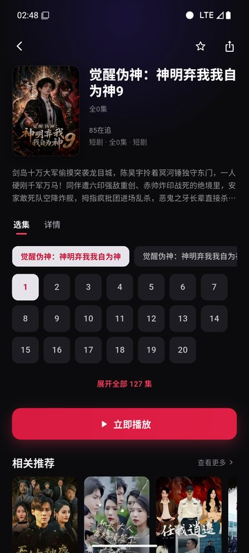
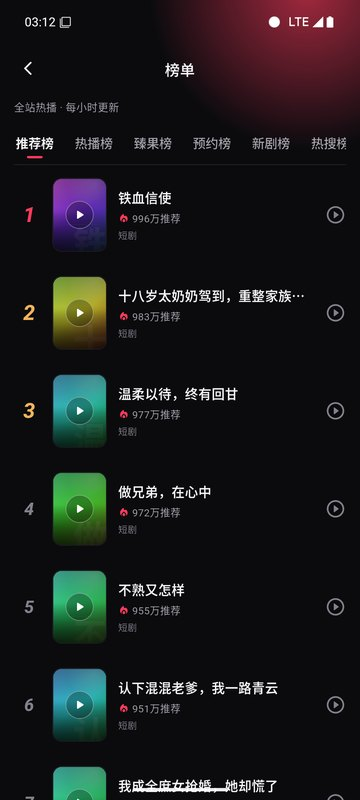
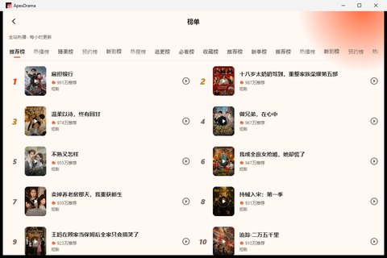

# ApexDrama

第三方短剧客户端，非官方、免登录、免费使用。

<a href="https://trendshift.io/repositories/367301?utm_source=trendshift-badge&utm_medium=badge&utm_campaign=badge-trendshift-367301" target="_blank" rel="noopener noreferrer"></a>

[](https://github.com/Sxuan-Coder/open-apex-drama/releases/latest)
[](https://github.com/Sxuan-Coder/open-apex-drama/releases/latest)
[](https://github.com/Sxuan-Coder/open-apex-drama/releases/latest)
[](https://www.gnu.org/licenses/agpl-3.0)
[](https://apexdrama.sxapex.com)

## 截图

### 移动端

<table>
  <tr><th>首页</th><th>看剧</th><th>详情</th><th>播放页</th><th>榜单</th></tr>
  <tr>
    <td></td>
    <td></td>
    <td></td>
    <td></td>
    <td></td>
  </tr>
</table>

### 桌面端（Windows）

<table>
  <tr><th>首页</th><th>播放页</th></tr>
  <tr>
    <td></td>
    <td></td>
  </tr>
  <tr><th>详情</th><th>榜单</th></tr>
  <tr>
    <td></td>
    <td></td>
  </tr>
</table>

## 功能

免登录、匿名设备直连，无需账号即可看全站。Android 与 Windows 双端共用一套代码，
功能对等。

### 内容浏览

- **首页推荐**：多频道内容流与「换一换」，最近更新一屏直达
- **搜索**：按剧名搜索，结果即搜即看
- **分类与榜单**：按题材筛选，全站播放热度榜单每日更新
- **详情页**：剧情简介、多季切换、选集网格，一键收藏与系统分享

### 播放器（核心）

- **加密流解密播放**：内置解密与播放协议，自动处理签名与过期
- **多档清晰度**：播放中即时切换，无需退出重进
- **倍速与长按加速**：多档倍速常驻可选；长按画面临时加速，松手即回原速
- **选集与自动连播**：选集面板随手可开，播完自动进入下一集
- **进度续播**：每 5 秒保存进度，再次进入自动跳到上次位置
- **定时关闭**：15 / 30 / 60 / 90 分钟，或「播完本集」自动停止并退出
- **手势操作**：单击播放/暂停，横屏双击切换，左右滑动快进快退
- **控制层锁定**：横屏全屏可锁定，防误触；点锁角标解锁
- **弹幕**：独立播放层，开关、字号、速度、出现位置（滚动 / 顶部 / 底部）可调，
  点选立即生效

### 桌面增强（Windows）

- **键盘快捷键**：空格播放/暂停，←/→ 快退快进 10 秒，↑/↓ 或 PageUp/PageDown 切集，
  F 全屏，M 静音，Esc 退出全屏或小窗
- **小窗模式**：悬浮小窗继续播放，边看边做别的
- **窗口全屏与自适应布局**：宽窗口左侧导航，窄窗口底部导航

### 观看数据与多设备同步

- **追剧 / 收藏 / 历史**：本地保存，启动即恢复，无需登录
- **WebDAV 同步**：填入自己的 WebDAV 地址即可在多台设备间同步观看记录；
  支持自动同步（带防抖与冷却限流）与每日自动检查
- **封面取色**：本地只存取色种子，过期后仍能还原封面渐变，不依赖图片链接

### 应用内更新

- **自动检查更新**：启动后后台检查，GitHub 接口失败时回退国内镜像清单
- **多镜像并发下载**：三个国内镜像 + 官方直链同时下载，谁快用谁
- **下载前测速**：启动后后台实测各镜像首字节延迟，结果缓存 6 小时
- **一键安装**：Android 下载完成直接调起安装，Windows 提供安装器与 zip

### 外观

- **深浅双主题**：支持跟随系统，全程语义化配色，不写死颜色
- **沉浸式封面**：详情页封面取色渐变与氛围光，移动端竖屏沉浸式体验

## 系统要求

- Android 7.0+
- Windows 10 / 11（x64）

## 从源码构建

```bash
flutter pub get
flutter run                            # 调试运行
flutter build apk --release --split-per-abi   # Android 安装包
flutter build windows                  # Windows 产物
powershell -ExecutionPolicy Bypass -File tool\package_windows.ps1  # Windows 打包（zip + 安装器）
```

环境要求与签名配置见 [docs/build.md](docs/build.md)。

### SDK 说明

SDK 为水果平台短剧的非官方第三方库（Apache-2.0），通过 git 依赖引用自维护 fork
（含预编译原生库与最新播放协议修复），Android / iOS / Windows 源码构建均完整可用。

## 参与贡献

欢迎任何形式的贡献：修 Bug、加功能、改进文档、补充测试。动手前请先开一个 Issue
说明你想做什么，避免和别人重复劳动。

### 开发环境

| 项目 | 要求 |
|---|---|
| Flutter | 稳定版，Dart SDK `^3.13.7`（以 `pubspec.yaml` 为准），CI 使用 3.47.9 |
| Android | Android SDK 与构建工具链，JDK 17；`flutter doctor` 全绿即可 |
| Windows | Visual Studio 2022，勾选「使用 C++ 的桌面开发」工作负载 |
| Git | 依赖里有 git 仓库形式的 SDK，需要能访问 GitHub |

安装好 Flutter 后先确认环境：

```bash
flutter doctor
```

### 本地运行

```bash
git clone https://github.com/Sxuan-Coder/open-apex-drama.git
cd open-apex-drama
flutter pub get          # 拉取依赖（含 git 依赖的 SDK 与预编译原生库）
flutter run              # 调试运行，有多个设备时会让你选
flutter run -d windows   # 只跑 Windows 桌面版
flutter run --dart-define=USE_MOCK=true   # 用内置假数据启动，不连真实接口
```

提交前必须通过的两项检查：

```bash
flutter analyze          # 静态检查，必须零 issue
flutter test             # 全部单元 / widget 测试
```

完整的构建、签名、打包与版本号规则见 [docs/build.md](docs/build.md)。

### 贡献流程

1. **Fork** 本仓库，然后 clone 到本地。
2. **新开分支**：从最新的 `master` 拉出，按改动类型加前缀：
   `feat/`（新功能）、`fix/`（修 Bug）、`docs/`（文档）、`refactor/`（重构）、
   `test/`（测试）、`chore/`（杂项）。不要直接在 `master` 上提交。
3. **提交**：使用语义化 commit，格式为 `<type>(scope): <摘要>`，
   例如 `feat(player): 支持长按临时倍速`。一个 commit 只做一件事。
4. **提 PR**：合并目标为 `master`。**每个 PR 的粒度尽量细**，一个 PR 只解决一个问题；
   大功能请拆成多个可以独立合并的小 PR。
5. **等待 CI**：`flutter analyze` 与 `flutter test` 全绿后由维护者合并（使用 merge commit，
   保留分支历史）。

补充约定：

- 单次改动超过 400 行必须走 PR，不能直接推 `master`。
- 文案用中文，代码标识符用英文；界面颜色走主题里的语义化配色，不要写死色值。
- 界面层不要直接引用底层 SDK，数据访问统一走仓库层。
- 新增用户可见的行为变化时，请同时补充或更新对应的测试。

### PR 格式

PR 描述固定分三块，**可以附图片或 GIF 辅助说明**（界面改动建议带上前后对比截图）。

```markdown
## Why to do

为什么要做这个改动？说明背景和要解决的问题，例如：
- 用户反馈横屏时容易误触
- Issue #123：选集面板点不中

## How to do

怎么做的？说明实现思路和改了哪些地方，例如：
- 新增控制层锁定状态，锁定后屏蔽手势
- 改动文件：`lib/screens/player_screen.dart`、`lib/widgets/...`

## How to test

怎么验证的？写清实际跑过的命令和结果，没验证到的也要说明，例如：
- `flutter analyze` 零 issue
- `flutter test` 全量 215 个用例通过
- Android 模拟器实测：锁定后手势不响应（见下图）
- 未在真机验证：iOS
```

## 开源协议

本项目以 [GNU AGPL-3.0](LICENSE) 协议开源：可自由使用、修改、再分发；
闭源套壳或基于本项目的网络服务同样须开源修改后的源码。
第三方依赖中 `openhongguo` 为 Apache-2.0，其授权声明独立生效。

## 免责声明

本项目仅供学习研究，禁止商业用途与大规模采集。接口与内容版权归原平台所有，
使用风险自负，如触及版权方利益请联系删除。

**详细说明：**

1. **非官方项目**：本项目是第三方客户端，与「水果」平台及其关联公司没有任何关联，
   未获得其授权、认可或赞助；项目中出现的平台名称仅用于说明数据来源。
2. **仅供学习研究**：本项目仅用于技术学习与交流，禁止用于商业用途，禁止利用本项目
   进行大规模采集、爬取或任何对平台造成负担的行为。
3. **内容版权**：通过本项目播放的短剧、封面、弹幕等内容，其版权归原平台及相应权利人
   所有。本项目不存储、缓存或二次分发任何短剧内容，仅在用户设备上调用平台接口播放。
4. **不保证可用性**：平台接口可能随时变更、限流或封禁，本项目不对功能的持续可用性
   作出任何承诺，也不对由此导致的无法播放、数据错误等情况承担责任。
5. **风险自担**：用户应自行评估并承担使用本项目产生的一切风险与后果。因使用本项目
   而违反平台用户协议或所在地区法律法规的，由用户自行承担全部责任，与本项目及
   其开发者无关。
6. **侵权处理**：若本项目触及任何权利方的合法权益，请通过 GitHub Issue 联系，
   我们将在核实后及时处理（删除相关内容或停止维护）。

## 致谢

- [openhongguo](https://github.com/beilunyang/openhongguo) — 水果平台短剧非官方 SDK（Apache-2.0）；
  通过 git 依赖引用自维护 fork [Sxuan-Coder/openhongguo](https://github.com/Sxuan-Coder/openhongguo)
  （含预编译原生库与 Windows 桥接）
- [media_kit](https://github.com/media-kit/media-kit) — mpv 内核播放器
- [Flutter](https://flutter.dev) / [Riverpod](https://riverpod.dev)
- [linux.do](https://linux.do/) — 开发者交流社区

---

如果这个项目对你有帮助，欢迎点个 Star ⭐

## Star 历史

[](https://star-history.com/#Sxuan-Coder/open-apex-drama&Date)
